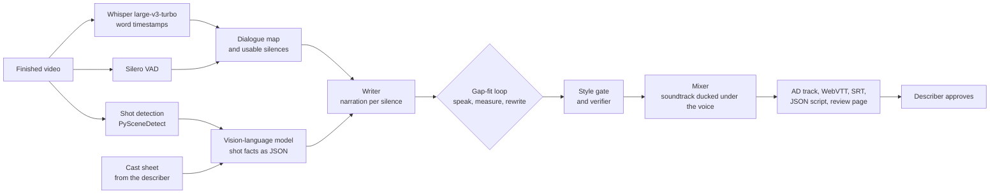

# GapCaster Small

**Human-Scale edition of GapCaster: offline audio description that fits the silences, on small open models, in English and Mandarin.**

GapCaster Small drafts an audio-description (AD) track for a finished video. It finds the silences between lines of dialogue, writes narration sized for each one, speaks it, measures it, and speeds it up slightly or rewrites it until it fits. Every line comes with the evidence behind it, and a human describer approves the result. Everything runs locally on open models of **10 billion parameters or fewer**; nothing is uploaded.

> **Relationship to GapCaster.** This repository is a continuation of [tedinroc/gapcaster](https://github.com/tedinroc/gapcaster) (full history included). The original repository is a competition entry and stays frozen as submitted. Development for blind and low-vision communities in Taiwan, the 8B default profile and Mandarin narration happen here.

**What is different here**

| | GapCaster (original) | GapCaster Small (this repo) |
|---|---|---|
| Default vision-language model | Qwen3.8-27B, 8-bit | **Qwen3-VL-8B-Instruct, 8-bit** (27B kept only as an optional quality reference) |
| Largest model core to the pipeline | 27B | **8B** |
| Narration languages | English | English and **Mandarin (Traditional Chinese text, `--lang zh`)** |
| Describer interface | Static `review.html` + CLI export | **Local Web Studio (`gapcaster web`, `127.0.0.1`)** with one-click browser export + static `review.html` |
| Peak memory on the 2:20 test clips | 33.2 GB | **13.7 GB** (EN, 8B) · **13.6–13.8 GB** (Mandarin, 8B) |

## Results on small models (laptop, in-sample + held-out Taiwanese documentary)

Measured on an Apple M5 Max laptop across two 0:00–2:20 excerpts:
- **In-sample development clip**: *Tears of Steel* (Blender Foundation, CC BY 3.0; English dialogue).
- **Held-out native Taiwanese Mandarin documentary**: *Young Coffee Story* (《【Young Coffee Story】人物紀實短片》，台灣失智症協會 Taiwan Alzheimer's Disease Association / 觀賞故事, CC BY 3.0; Taiwanese Mandarin dialogue with burned-in bilingual open captions and slow cross-dissolves).

| 0:00–2:20 | 27B, EN (*ToS* ref) | **8B, EN (*ToS*)** | **8B, Mandarin (*ToS*)** | **8B, Mandarin (*Young Coffee*, held-out)** |
|---|---:|---:|---:|---:|
| Lines that fit their silence | 17/17 | 19/19 | 15/15 | **13/13** |
| Narration over detected speech | 0.0 s | 0.0 s | 0.0 s | **0.0 s** |
| Narration over official subtitle cues | 0.4 s | 0.6 s | 0.4 s | n/a (open-captioned source) |
| Verifier: obvious planted errors flagged | 17/17 | 18/19 | 13/15 | **12/13** |
| Verifier: subtle in-film errors flagged | 15/17 | 13/19 (verb swaps 0/5) | 11/15 (char/neighbour) | **12/13** (neighbour swaps) |
| Verifier flags on unmodified lines | 1/17 | 2/19 | 1/15 | **3/13** (all 3 true dissolve-timing leads) |
| AI-assisted frame check: accurate · minor · wrong | 13 · 4 · 0 | — | 7 · 7 · 1 | **6 · 5 · 2** |
| Processing per content minute | 125 s | 50 s | 39 s | **39 s** |
| Peak model memory | 33.2 GB | 13.7 GB | 13.8 GB | **13.6 GB** |

What the numbers say: across both an English sci-fi film and a held-out Taiwanese documentary, the 8B profile preserves every timing guarantee (100% of placed lines fit; `0.0 s` narration over detected speech) at ~13.6–13.8 GB peak memory. On *Young Coffee Story*, all three verifier flags on unmodified lines (`AD002`, `AD006`, `AD013`) were genuine catches where a slow cross-dissolve moved past or had not yet reached the action described—catching one of the two wrong lines (`AD002`) and leaving one unflagged error (`AD012`, a brief cycling-photo B-roll cut-in inside an interview shot) for the human describer to reject. Per-line notes are in [`eval/spotcheck_tears_of_steel_0-140_zh.csv`](eval/spotcheck_tears_of_steel_0-140_zh.csv) and [`eval/spotcheck_young_coffee_0-140_zh.csv`](eval/spotcheck_young_coffee_0-140_zh.csv). Human describer review and blind and low-vision listener ratings are underway ([listening pilot](https://ad-listen.pages.dev/)).

Provenance: the 8B English sample ([`samples/tears-of-steel-0-140-8b`](samples/tears-of-steel-0-140-8b)) was produced with `GAPCASTER_VLM` pointing at Qwen3-VL-8B. Both Mandarin samples ([`samples/tears-of-steel-0-140-zh`](samples/tears-of-steel-0-140-zh) and held-out [`samples/young-coffee-0-140-zh`](samples/young-coffee-0-140-zh)) were produced by this repository with `--lang zh --inject 20`.

### Mandarin narration & Taiwanese documentary adaptations (`--lang zh`)

- Budget in characters, not words: ⌊window × 4.0 字/s⌋, from 4 to 40 characters. The default voice, Kokoro `zf_xiaobei`, speaks about 4.3 characters per second.
- Narration is written and stored in Traditional Chinese with Taiwan phrasing (OpenCC `s2twp`). It is converted to Simplified only on the way into the TTS front end, whose Mandarin G2P expects Simplified characters.
- Shot facts stay in English, where the vision model is most reliable. The writer reads them and writes in Mandarin; untranslated lowercase English common nouns leaked from the facts (e.g. *succulent*) are blocked by the deterministic Mandarin style gate and rewritten into Chinese (`多肉植物`), while on-screen proper names (`Young`) are exempt.
- **Open-caption & BGM watermark guards for Taiwanese media:** almost all Taiwanese online/TV video burns open dialogue subtitles into the frame (`is_spoken_subtitle()` suppresses on-screen text that merely repeats surrounding ASR speech so dialogue is not read twice), and `filter_segment_words()` strips known Whisper Chinese BGM watermarks (`字幕志願者 李宗盛`, etc.) and single-word silence phantoms.
- **Soft-dissolve subdivision:** documentary montages built with slow cross-dissolves rather than hard cuts are subdivided into ≤8 s windows in `scenes.shots()` so title cards and archival photos are not collapsed into a single shot.
- The style gate has Mandarin rules: 我們看到／鏡頭 (camera language), 似乎／好像／可能 (speculation), 我／我們 (first person) and leaked English common nouns are hard blocks; emotion words, evaluative words and similes are flagged. Text read verbatim (「…」 or 字幕：…) is exempt.
- A caption line written when no unread text is on screen is treated as a hallucinated reading: the writer is asked once for the visible action instead, otherwise the line is dropped.
- Cast sheets carry Chinese names and `named_from` timestamps ([`configs/cast_tears_of_steel_zh.yaml`](configs/cast_tears_of_steel_zh.yaml), [`configs/cast_young_coffee_zh.yaml`](configs/cast_young_coffee_zh.yaml)).
- Known gaps: foreign title cards (`YOUNG COFFEE STORY`, `SIMULATION READY...`) are sometimes read in English rather than translated; Kokoro's Mandarin voice is a mainland-accent stock voice, and a Taiwanese voice is needed; short B-roll photo inserts inside a single sub-shot (`AD012`) can still be missed; noun/verb planted-error sets need a Chinese POS tagger.

```bash
gapcaster run young_coffee.mp4 --out runs/yc-zh --cast configs/cast_young_coffee_zh.yaml \
  --start 0 --end 140 --lang zh --inject 20
```


**Start here:** [Project page](https://tedinroc.github.io/gapcaster-small/) · [Native Taiwanese Mandarin sample (*Young Coffee Story*)](samples/young-coffee-0-140-zh/) · [Mandarin *Tears of Steel* sample](samples/tears-of-steel-0-140-zh/) · [8B English sample](samples/tears-of-steel-0-140-8b/clip_with_ad.mp4) · [Listening pilot for blind and low-vision listeners](https://ad-listen.pages.dev/) · [Run locally](#quick-start)

Built by Ted Chen with AI coding assistance (Claude, Anthropic).

---

The rest of this README describes the pipeline, which is the same in both repositories; numbers marked "27B" come from the original runs.

## How it works



1. **Map the silences.** Two independent detectors: Whisper word timestamps (low-confidence shouts are kept; only known Whisper artefacts such as repetition loops are dropped) and Silero VAD. A moment counts as dialogue if either hears speech; pauses under 0.6 s stay inside a span. A silence is usable from 0.25 s after a line ends to 0.30 s before the next starts. Long silences are split at shot cuts, and a silence can stay empty when nothing new is on screen, as AD guidelines advise.
2. **Read every shot.** A vision-language model returns JSON facts for each shot: who, where, action, on-screen text, the key visual fact and a confidence score. A short cast sheet written by the describer keeps names consistent; each entry can carry a `named_from` time, and before it the person is described by look.
3. **Write to budget.** Narration for each window, with a word budget of ⌊window × 2.6 words/s⌋ (3 to 18 words). Unread story text (title cards, headlines), including text from the shot that just cut away, is queued for the writer, and a draft that ignores it gets one forced rewrite. A pattern list keeps studio cards, credits and web addresses out of the narration.
4. **Gap-fit loop.** Kokoro TTS speaks the line and the trimmed audio gives its real duration. If it overflows, the line is tried at 1.08× and 1.15× speed, then the writer is told the exact overflow and asked for a shorter line (up to three rounds).
5. **Style gate.** Deterministic rules from professional AD practice block camera language ("we see"), speculation ("seems", "maybe") and first person, and flag inner-state words, evaluative words and similes. On-screen text read verbatim is exempt. Lines that repeat the last two are dropped.
6. **Verify, review, mix.** A verifier checks each line against the facts of the shots on screen while it plays and flags unsupported claims (no verdict is also flagged). ffmpeg mixes the narration in, with the soundtrack ducked under the voice. On the review page the describer approves, edits or rejects each line; `gapcaster export <run_dir> --approved approved.json` re-mixes only approved lines and re-times edited ones.

A real case from the 140-second run (`AD008`, silence of 2.75 s, budget 7 words): *A headline: Roboticist creates killer robots.* is 2.78 s at normal speed, so it is tried at 1.08× and fits at 2.64 s.

And the style gate at work in the full film (`AD001`): *A caption: Blender Foundation Presents.* is blocked (credits) and redrafted as *White text on black background.* (1.66 s, fits).

## Quick start

Requirements: an Apple Silicon Mac with at least 24 GB of unified memory for the default 8B profile (peak use is about 14 GB; the optional 27B reference profile needs 48 GB or more), about 15 GB of free disk for the default models, Python 3.11–3.13, [uv](https://docs.astral.sh/uv/) and `ffmpeg` on PATH. You can inspect the sample outputs without any models: open `samples/tears-of-steel-0-140/review.html`.

```bash
git clone https://github.com/tedinroc/gapcaster-small.git
cd gapcaster-small
uv venv --python 3.11 && source .venv/bin/activate
uv pip install -e ".[mac,zh]"

# launch the local-only Describer Web Studio (inspect bundled EN + zh samples immediately, no models needed):
gapcaster web --open

# or run from the command line on the demo film:
curl -LO https://download.blender.org/demo/movies/ToS/tears_of_steel_720p.mov
curl -LO https://download.blender.org/demo/movies/ToS/subtitles/TOS-en.srt

gapcaster run tears_of_steel_720p.mov --out runs/demo --cast configs/cast_tears_of_steel.yaml \
  --start 0 --end 140 --ref-srt TOS-en.srt --inject 20
open runs/demo/review.html
# after reviewing, export directly in `gapcaster web`, or download approved.json and run:
gapcaster export runs/demo --approved approved.json
```

Each stage can switch runtime. For an Intel GPU on Linux, install the XPU build of PyTorch first so Kokoro can use the card:

```bash
uv pip install torch --index-url https://download.pytorch.org/whl/xpu
uv pip install -e ".[intel]"
# vLLM / Intel llm-scaler serving the model as "qwen" (--served-model-name qwen)
gapcaster run tears_of_steel_720p.mov --out runs/b70 --backend openai --base-url http://<server>:8000/v1 --model qwen \
  --concurrency 8 --asr openvino --asr-device GPU --tts kokoro
```

On Linux, OpenCV (pulled in by PySceneDetect) needs `libgl1`.

| Stage | `mlx` (laptop) | Portable runtime | Status of the portable runtime |
|---|---|---|---|
| Vision-language model | mlx-vlm, in-process | any OpenAI-compatible server (`--backend openai`, `--concurrency`) | client implemented and run against a local stand-in; not yet validated on a GPU server |
| Speech recognition | mlx-whisper | OpenVINO GenAI WhisperPipeline (`--asr openvino`, CPU or GPU) | runs on a laptop CPU: dialogue map IoU 0.835 against MLX (both include the shared VAD spans; speech-recognition-only IoU 0.77) |
| Text-to-speech | mlx-audio Kokoro | PyTorch Kokoro (`--tts kokoro`, CPU or XPU) | runs on a laptop CPU: line durations within 33 ms of MLX |

The whole portable path has also run end to end on a laptop: `--backend openai --concurrency 4` against the local stand-in server in `eval/local_server.py` (it serves one request at a time; it checks the code path, not throughput), with `--asr openvino --tts kokoro`, on a 50-second window (7/7 lines fit; [`samples/portable-path-e2e-metrics.json`](samples/portable-path-e2e-metrics.json)). Set `GAPCASTER_VLM` to use a model folder that is already on disk.

Tests and checks:

```bash
uv pip install -e ".[dev]" && pytest -q                 # unit tests; no models needed
uv pip install -e ".[mac,intel]"                         # Apple Silicon, both runtimes
python eval/parity.py runs/demo                          # MLX vs OpenVINO/PyTorch speech path
```

## Outputs

| File | What it is |
|---|---|
| `clip_with_ad.mp4` | Programme with the description mixed in |
| `ad_track.wav` | Description voice only, time-aligned |
| `ad.vtt` | WebVTT text track, `Kind: descriptions` |
| `ad.srt`, `ad_script.txt` | Script with timings |
| `script.json` | Everything: shots and their facts, dialogue map, silences, every draft, timings, flags, metrics |
| `review.html` | Review page: evidence per line; Approve, Edit, Reject; download `approved.json` and an approved WebVTT |
| `approved/` | After `gapcaster export`: the re-mixed programme and tracks with only approved lines |

## Known limitations

- The writer sees every shot in its silence, but a short line may finish before a later shot appears; in the full film 10 of 70 lines were written partly from such shots, and these account for about half the verifier's flags. Planned fix: rewrite a line from only the shots on screen while it plays.
- The text gate forces one rewrite; a later shortening for time can still drop the text (two cases in the full film).
- End-credit rolls slipped through the credits pattern in the full-film run; the pattern has since been extended.
- Mandarin narration has been measured on two 140-second clips (*Tears of Steel* in-sample and *Young Coffee Story* held-out); full-length Taiwanese documentaries and listener comprehension studies are next.
- Timings were measured on a laptop that was also running other jobs; they will be re-timed on an idle machine.

## Other hardware

The orchestrator does not depend on Apple Silicon: the vision-language model can be served by any OpenAI-compatible server (for example vLLM on an Intel Arc or NVIDIA card), speech recognition can run on OpenVINO (CPU or GPU) and Kokoro on PyTorch (CPU or Intel XPU). The hardware study that targets a single 32 GB Intel Arc Pro B70 card is documented in the original [GapCaster repository](https://github.com/tedinroc/gapcaster#stage-ii-one-asus-ugen-intel-arc-pro-b70). Here the goal is the smallest machine that does the job well: the 8B profile's ~14 GB peak should fit 24 GB laptops and 16 GB GPUs with 4-bit weights. That still has to be measured.

## Project layout

```
gapcaster/      pipeline: media, scenes, gapmap (Whisper MLX/OpenVINO + VAD), llm (MLX + OpenAI
                backends), tts (MLX/PyTorch), lang, prompts, styleguard, inject, pipeline,
                export, review, approve, web (local Describer Studio), cli
eval/           parity check for the portable speech path; local OpenAI-compatible test server;
                AI-assisted frame checks (Tears of Steel + Young Coffee Story)
configs/        cast sheets for Tears of Steel (EN/zh) and Young Coffee Story (zh)
samples/        outputs of the 140-second demo runs (8B EN, 8B Mandarin Tears of Steel, 8B
                Mandarin Young Coffee Story held-out, 27B reference); full-film script; metrics
tests/          unit and HTTP studio tests (pytest)
```

## Credits and licences

- Code: MIT, © 2026 Ted Chen. Developed with AI coding assistance (Claude, Anthropic; Gemini, Google).
- Demo footage and frames:
  - *Tears of Steel* © Blender Foundation | mango.blender.org, licensed [CC BY 3.0](https://creativecommons.org/licenses/by/3.0/). `samples/tears-of-steel-0-140*/clip_with_ad.mp4` are excerpts (0:00–2:20) with GapCaster's synthetic description track mixed in; they are modified works and are not endorsed by the Blender Foundation. Score by Joram Letwory (www.tearsofsteel.org), heard as part of the CC BY 3.0 film; the separately released soundtrack files are CC BY-ND 3.0 and are not used. Official subtitles are used only for evaluation.
  - *Young Coffee Story* (《【Young Coffee Story】人物紀實短片_台灣失智症協會｜觀賞故事》, [YouTube `K3YuJ_aXPDQ`](https://www.youtube.com/watch?v=K3YuJ_aXPDQ)) © 台灣失智症協會 (Taiwan Alzheimer's Disease Association) / 觀賞故事, licensed under Creative Commons Attribution ([CC BY 3.0](https://creativecommons.org/licenses/by/3.0/)). `samples/young-coffee-0-140-zh/clip_with_ad.mp4` is a 0:00–2:20 excerpt modified to mix in GapCaster Small's synthetic Mandarin audio-description draft and is not endorsed by the Taiwan Alzheimer's Disease Association.
- Models: Qwen3-VL-8B-Instruct (Apache-2.0; default), Whisper large-v3-turbo (MIT), Silero VAD (MIT), Kokoro-82M (Apache-2.0), optional reference Qwen3.8-27B (Apache-2.0). Voices are synthetic stock voices; no voice cloning.
- Libraries include MLX, mlx-vlm, mlx-audio, OpenVINO GenAI, PyTorch (BSD-3-Clause), PySceneDetect and spaCy. Kokoro's English G2P falls back to espeak-ng (GPL-3.0) for out-of-vocabulary words; the library comes in the espeakng-loader wheel that misaki[en] installs, is loaded at runtime, and is not redistributed by this repo. ffmpeg is called as a subprocess.
